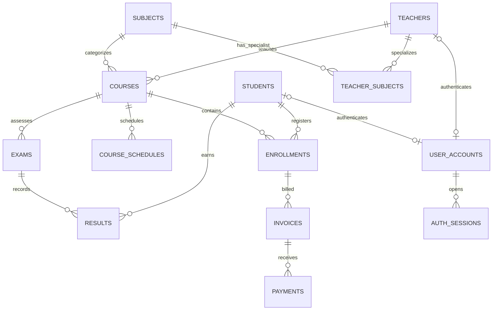

# ER model and normalization

## Main relationships

- `enrollments` is the many-to-many bridge between `students` and `courses`. A unique `(student_id, course_id)` key prevents duplicate enrollment records.
- `teacher_subjects` is the many-to-many bridge between `teachers` and `subjects`.
- `results` connects students to exams and has a unique `(exam_id, student_id)` key.
- An enrollment may have multiple invoices over time; an invoice may have multiple payment transactions.
- Administrator, teacher, and student login credentials are stored in `user_accounts`; teacher/student accounts reference at most one matching profile. Session tokens are stored only as hashes in `auth_sessions`.

## 3NF notes

- Each table has a primary key and stores attributes belonging to that entity/relationship.
- Teacher and subject details are not copied into each course; courses reference their IDs.
- Student contact/discount information is stored once in `students` and referenced by enrollments.
- Payment transactions are separate from invoices. The invoice stores a billing-time snapshot of base fee, discount rate, discount amount, and final amount due; this preserves historical billing when a student's discount changes later.
- Amount paid and outstanding balance are derived from payment rows in `v_invoice_balances`, not duplicated as editable totals.
- `CHECK`, `UNIQUE`, foreign-key constraints, indexes and triggers enforce domain and integrity rules in PostgreSQL.
